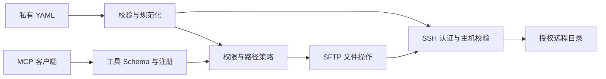

# 架构

Node.js ESM 单进程，通过官方 MCP SDK v2 提供 stdio 工具，通过 ssh2 发起 SSH/SFTP 请求。读、写、删权限由挂载配置决定；无需远端 Agent、HTTP 服务、数据库或编译步骤。

## 模块

| 模块 | 职责 |
| --- | --- |
| `src/index.js` | CLI、初始化、stdio 生命周期与退出清理 |
| `src/config/` | 有界读取 YAML、严格 Schema、默认值、本地路径和凭据引用 |
| `src/ssh/` | 认证、有限 SSH 配置解析、known_hosts、按服务器管理连接 |
| `src/security/` | 挂载授权、逐段路径检查、操作截止时间、并发与审计 |
| `src/sftp/` | 有界读写、目录与搜索、修改预校验、归档解析和解压写回 |
| `src/tools/` | 工具 Schema、注册和统一调度，不自行跳过策略 |
| `src/common/` | 集中的权限、错误码、状态、默认值和固定上限 |

通过普通函数和运行期对象组合模块；测试替换连接/SFTP 边界，不引入通用插件系统或依赖注入框架。

## 生命周期

启动时只验证本地配置、身份及 known_hosts，按 serverId/mountId 建立 Map 索引，不探测远端。list_mounts 只使用公开配置。

每台服务器最多一个惰性 SSH 连接，并发调用共享建连。单个等候者取消只移除自身，无等候者时才取消尚未完成的建连。连接失败后清理，下一次调用才重新建立；不后台重试。

每次操作申请独立 SFTP channel 和全局名额。截止时间涵盖排队、建连、路径检查与读取。正常完成关闭句柄和 channel；取消/超时禁止新增 I/O，忽略迟到回调并释放名额。SSH 故障使该连接上的在途请求失败，不自动重放。

stdin EOF、SIGINT/SIGTERM 触发关闭；停止新请求、取消在途操作并释放连接，保留强制退出上限。配置变化通过重启生效。

## 文件调用顺序

1. 严格检查参数、server/mount ID 和 read/write/delete 权限；跨挂载动作检查两端。
2. 校验原始相对路径，再构造候选路径并检查包含关系。
3. 取得操作名额、连接及 SFTP channel。
4. 从远端根逐段 lstat，拒绝链接与不合适的目标类型。
5. 按封装动作处理：读取/搜索、写入、目录/移动/删除或归档。文件打开后 fstat，修改前校验目标；每次 I/O 都检查操作状态。
6. 生成有界结构化响应、清理资源并记录脱敏审计。

归档仅在本地用 zlib、tar-stream 和 yauzl 解析，通过 CRC 校验 ZIP 正文，不执行服务端 tar/unzip。解压前先校验全部归档内容与目标，再通过 SFTP 创建目录和分块写入。搜索可直接扫描压缩内容，结果保留归档路径和成员名。

修改类请求在发送可能改变文件系统的 I/O 前标记状态；此后失败返回 mayHaveChanged，禁止自动重放，不承诺跨文件事务或回滚。删除、移动和解压预校验有总条目预算；客户端检查不能消除 TOCTOU。

接口以[工具参考](../reference/tools.md)为准；资源配置见[配置](../usage/configuration.md)，权限保障的边界见[安全模型](../security/model.md)。
